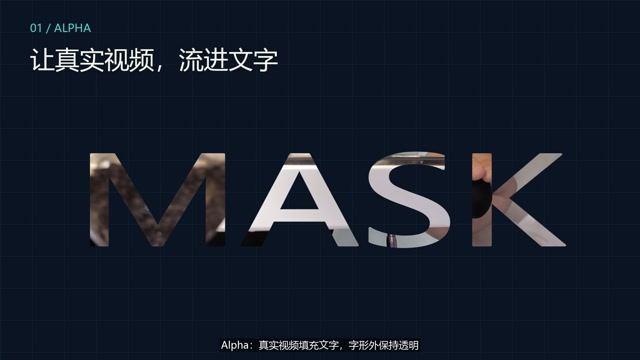

# Self Media Workbench · 自媒体 Agent 工作台

[中文](#中文) · [English](#english)

面向 AI Agent 的 Windows / macOS 本地自媒体工作台，采用 MIT 协议。

An MIT-licensed local self-media workbench for AI Agents on Windows and macOS.

## 中文

由调用工作台的 AI Agent 选择功能、续做项目、创作内容、审阅剪辑并交付有版本记录的结果。工作台无需浏览器表单、Node 运行时或模型 API 密钥。

**对 Agent 直接说任务即可：**“诊断这个账号并选题”“只改这份口播稿”“剪这个视频并检查字幕”“继续上次项目做复盘”。统一入口会准备项目、材料、状态和起点；调用它的 AI Agent 继续完成推理和执行。入口返回计划本身不代表已完成内容创作。

### 样片：看实际输出

| 高级口播 · 90 秒 | 剪辑特效声画版 · 95.8 秒 |
|---|---|
| [](https://github.com/MkaliezZ/self-media-workbench/releases/download/showcase-2026-10-25/advanced-talking-90s.mp4) | [](https://github.com/MkaliezZ/self-media-workbench/releases/download/showcase-2026-10-25/effects-with-audio-95s.mp4) |
| [播放／下载 MP4](https://github.com/MkaliezZ/self-media-workbench/releases/download/showcase-2026-10-25/advanced-talking-90s.mp4)：以自媒体运营逻辑串起关键词匹配、前景遮挡、原文抽离、对照图解与复盘。 | [播放／下载 MP4](https://github.com/MkaliezZ/self-media-workbench/releases/download/showcase-2026-10-25/effects-with-audio-95s.mp4)：14 组文章标黄、透视拉正、聚光灯、画中画、视频填字、Alpha／亮度／反向遮罩与转场。 |

两条均为实际导出的 1080p / 25fps 成片，包含合成旁白、BGM 与轻音效。90 秒样片使用有室内背景的 AI 静态人物图，无口型动画；原始口播视频实际经过 CUDA ASR，按原时间边界整理字幕。图像与声音生成在工作台外完成，剪辑与合成由工作台执行。[分段说明、文件校验与媒体许可](docs/demos/README.md)。

### 给其他 Agent 的快速开始

**两种口播流程：**普通口播侧重原意、删音、字幕和必要配图；**高级口播**先按语义拆镜，再安排分层遮挡、纸页透视、关键词扫描、原文抽离、关系图和声音。统一入口返回 `talking_profiles`，Agent阅读[高级口播说明](skills/self-media-workflow/references/advanced-talking.md)，编译成原生时间轴并实际导出。静态人物图与合成旁白可作已声明的模拟素材；生成模型/服务另行准备。多阶段透视是平面合成，声音信号检查不代替听审。

把仓库链接和任务发给具备文件读写、终端执行能力的 Agent 即可，无需让使用者记安装或启动命令：

```text
https://github.com/MkaliezZ/self-media-workbench
我的任务：[填写要完成的事；续做时注明项目名称或ID，附上相关素材]
```

**收到链接和任务的 Agent：**先阅读本 README、[AGENTS.md](AGENTS.md) 和相关入口说明，按下面的执行约定自行完成安装、配置、启动和续做。也可以将这段完整说明直接转发给其他 Agent：

```text
请使用这个 Agent 自媒体工作台完成我的任务：
https://github.com/MkaliezZ/self-media-workbench

先阅读仓库 README、AGENTS.md 和相关入口说明，再自行执行。优先复用已有安装；没有则克隆仓库。检查当前 Windows/macOS、Python、依赖、FFmpeg及任务所需的 ASR/GPU 环境，按仓库文档安装缺项、配置兼容模型并验证实际后端。仅在任务需要时安装音视频依赖；GPU不可用时如实记录原因和CPU回退，不得把未实测能力说成通过。

由你管理命令、配置、服务启动和项目状态，不要求我记命令、填写JSON或提供模型路径。通过统一 Agent 入口判断功能和起点：已有项目读取实际进度后续做，保留原始素材、历史结果和失败记录；多个项目无法确定时才询问。入口返回的计划不算完成，请实际执行、保存结果并检查产物，最后说明完成内容、产物位置和未解决事项。涉及付费、覆盖已有数据或对外发布时先取得明确授权。

我的任务：[填写要完成的事；续做时注明项目名称或ID，附上相关素材]
```

安装阶段由 Agent 显式下载和配置任务所需的兼容模型；正常转写不会自行下载模型。续做依赖本机已有的项目数据，换机器时需要先提供原项目数据目录或备份。下方命令供 Agent 执行和排错参考。

### 安装

完整音视频流程需要 Python 3.11+、FFmpeg 和 ffprobe。纯文本任务不需要 FFmpeg 或 ASR 模型。

```sh
git clone https://github.com/MkaliezZ/self-media-workbench.git
cd self-media-workbench
python -m venv .venv
```

Windows PowerShell：

```powershell
.\.venv\Scripts\Activate.ps1
python -m pip install -r requirements-dev.txt
choco install ffmpeg
```

macOS 终端（如果没有 `python`，创建虚拟环境时使用 `python3`）：

```sh
source .venv/bin/activate
python -m pip install -r requirements-dev.txt
brew install ffmpeg
```

仅运行文本功能可安装 `requirements.txt`；转写另加 `requirements-asr.txt`。`requirements-dev.txt` 包含这两者及测试依赖。安装依赖不会下载 ASR 模型。配置已有的本地 CTranslate2 faster-whisper 模型：

```sh
python workbench.py configure --model /absolute/path/to/faster-whisper-model
python workbench.py doctor
python workbench.py install-skill
```

在原生 Apple Silicon macOS 上，Agent 还可以安装 `requirements-mlx.txt`，并配置 **MLX 格式**的本地模型：

```sh
python -m pip install -r requirements-mlx.txt
python workbench.py configure --mlx-model /absolute/path/to/mlx-whisper-model --asr-backend auto --device auto
python workbench.py doctor
```

自动选择依据实际显示 GPU：NVIDIA 优先使用 faster-whisper/CUDA；Windows AMD/Intel GPU 使用另行安装的 whisper.cpp/Vulkan；Apple Silicon 使用 MLX/Metal；Intel Mac 可使用另行配置的 whisper.cpp/Metal。缺少组件或加速失败时，记录原因再回退 CPU。显式选择 CPU 就使用 CPU；`require_gpu` 禁止 CPU 回退。CT2、MLX、GGML 权重格式不能混用，正常转写不下载模型。Agent 应读取 `doctor` 的策略和安装指南，并核对任务终态中的后端、设备及执行证据，不能把硬件检测当作 GPU 推理成功。[显卡策略与 Agent 配置](docs/accelerators.md) · [Apple MLX 验证](docs/apple-gpu.md)。

`install-skill` 将 `media-workbench` 入口安装到本机 Codex skills 目录，并在本机记录此仓库和 Python 解释器的位置。包装入口优先使用仓库的 `.venv`，其次使用记录的解释器，Agent 自身的其他 Python 不必重复安装相同依赖。其他 Agent 可直接阅读 [AGENTS.md](AGENTS.md)。安装 skill 后请保留此仓库目录；机器专属的位置记录不会提交到仓库。

### 一个 Agent 入口，多种任务

以下命令由 Agent 自行调用，使用者无需记忆：

```sh
python workbench.py run "只写这份素材的口播稿，不剪辑" --input /absolute/path/source.txt
python workbench.py run "继续这个项目做选题"
python workbench.py run "复盘我的项目" --project "project name" --input /absolute/path/metrics.json
```

入口自动启动或复用已核验身份的本地回环服务、登记输入，并返回项目、上下文、当前或过期的产物以及建议阶段。它不会自行调用外部大模型。调用它的 Agent 读取对应方法、创作产物并执行发现的工具。Codex、DSH 或其他具备工具执行能力的 Agent 均可使用。

| 功能 | 产物 |
|---|---|
| 账号诊断／可选对标 | 证据、优先问题、下一步行动 |
| 选题 | 有素材支撑的备选题与选定问题 |
| 脚本 | 口播词、镜头、时长估算与行动引导 |
| 本地剪辑 | 实际 ASR、明确的剪除与恢复、审阅后的字幕分组、MP4/SRT/JSON |
| 高级口播 | 按语义分场、冻结制作模板、平面关键帧、原像素逐行标黄／反相、前景遮挡、声音编排与真实导出 |
| 视觉编辑 | 完整字幕组强调、本地配图、静态区域高亮、方案与时间轴 |
| 行业与类型模板 | 十二类预设；Agent 生成自定义叙事/用镜/节奏/声音逻辑，按组件能力编译 |
| 发布准备 | 标题、配文、披露说明及真实素材绑定 |
| 原生时间轴 | 无旁白画面、多源/静帧、独立音轨、审阅音乐打点、标题、版本恢复 |
| 转场与蒙版 | 重叠转场、矩形/椭圆真 Alpha 蒙版、局部取景、向内羽化、PNG 透明区域保留 |
| 信息动效 | 文章标黄后抽离/透视拉正/放大/收回、局部放大、移动聚光灯、视频画中画入场、线性揭示与重点文字动效 |
| 复盘 | 有定义的指标或采集计划、假设与下一次实验 |

单项任务可直接进入脚本、剪辑或复盘；完整流程从最早缺失或过期的阶段续做。同一会话中说“继续”会续做当前项目；多个项目匹配时先确认选择。`--session` 用于隔离并行的独立会话。未知事实和缺失指标保持未知，旧稿、被拒请求与修订记录均保留。

项目状态默认保存在操作系统的私有应用数据目录。`configure --data-dir ...` 可复用已有项目库，无需移动或删除数据。`--skill-root` 和 `--library` 可选接入私有方法及知识目录。配置改变后需要重启运行中的服务。[配置与协议](docs/configuration.md)。

### 平台支持与验证范围

**2026-10-25 本轮：**Windows、Apple Silicon（ARM64）、Intel Mac（x86_64）的兼容性、高级口播、独立蒙版三组 CI 共 **9 个原生任务全部通过**。每端高级口播回归 78 项、独立媒体检查 27 项、扫描／蒙版补充检查 49 项；包含实际导出、声音整理、恢复与后台重启。Apple Silicon 另确认实际 MLX GPU 转写与导出，无 CPU 回退。云端 Windows／Intel Mac 的 ASR 为 CPU 基线，不能当作对应 GPU 实测。[本轮完整记录](evaluation/advanced-talking-20261025.md) · [CI 结果索引](evaluation/advanced-ci-20261025.json)。

Windows 支持 CPU，以及安装可选运行库后的 NVIDIA CUDA，并明确记录 CPU 回退；AMD/Intel GPU 的可选 whisper.cpp Vulkan 路径尚待实机验收。Apple Silicon 另支持可选 **MLX/Metal GPU** 和 CPU 回退；Intel Mac 默认使用 CTranslate2 CPU，可选 whisper.cpp Metal 路径尚未实机验证。FFmpeg 导出、状态及协议功能采用同一套 Python 实现。GPU 验证与 CPU 兼容性分别报告。

[当前显卡策略验收](evaluation/gpu-strategies-20261021.md)在 Windows、macOS 15 ARM64 和 Intel 上通过了 46 项测试及实际媒体检查。本地 NVIDIA CUDA、Vulkan 的实际执行与云端 Windows CPU 基线分别记录；ARM 也运行了实际 MLX/Metal GPU 推理。Windows AMD/Intel GPU 和 Intel Mac 可选 Metal 路径仍未完成对应硬件验收。早期 36 项测试的时间轴检查及 macOS 26 结果保留在[验证历史](docs/validation.md)。合成素材技术检查不能证明通用识别质量或加速比。

欢迎社区补充 AMD/Intel Vulkan 和原生 Intel Mac Metal 的实机测试。请按[同素材硬件验收与报告指南](docs/cloud-gpu-acceptance.md)保留原生日志、失败记录，并注明实际操作系统、显卡与模型。[免费环境调查](evaluation/vendor-cloud-20261021.md)未找到可立即使用的目标 GPU，排队中的云端探测已按维护者要求停止。这些路径继续标注为尚未实机验证。

独立的 [macOS 全新安装验收](evaluation/fresh-macos-20261021.md)在 Apple Silicon 和 Intel 上完成了 GitHub 全新克隆、隔离虚拟环境及模型缓存、模型配置持久化、Agent 入口安装、服务自动启动、首次脚本任务、实际 GPU/CPU 转写、审阅导出及项目续做。早期证据打包和过短字幕问题与修订后的复测结果同时保留。这是由 Agent 独立设计和审阅的确定性云端执行，并非云端实时大模型会话。

[中文口播验收](evaluation/chinese-acceptance-20261021.md)在 Windows、Apple Silicon GPU 和 Intel CPU 上使用同一份中文合成素材，保留原始识别错误、基于已知原稿的辅助纠错、字幕修订及实际停顿剪除／恢复导出。首次比较失败，以及后来自动检查通过但语义断句错误的字幕结果，均与最终三端复测结果一起保留。

普通导出保留独立 MP4/SRT。保存 visual-plan 后可另导出重点字幕、本地 PNG/JPEG 与静态区域提示的 visual.mp4，保留原件与旧导出。视觉与行业模板已在 Windows、macOS Apple Silicon 和 Intel 云端各通过 59 项测试及实际语音/导出检查，修订前失败也已保留；这些是合成素材技术检查，不是行业审美或真实运营验收。详见[视觉编辑](docs/visual-editing.md)。没有在线自动搜图或自动对外发布，也不保证内容或营销效果。模型识别、字幕、具有语义的停顿、生产可用性及平台要求仍需 Agent 审阅，必要时由人确认。

### 行业与视频类型模板

内置知识教学、财经商业、美业服务、电商产品、餐饮探店、家居房产、有旁白旅行 Vlog，以及补回的不露脸资料、科普、生活场景、游戏事件回看和第一人称解说。Agent 还可按行业、视频形式、观看目的与素材条件生成项目专用逻辑，每段说明画面、节奏和声音，保存定义/版本后编译为实际方案。纯画面、多源及审阅后的音乐打点现使用[原生时间轴](docs/native-timeline.md)，无须 ASR；跟踪、复杂组动画、变速与音乐生成仍列为缺项。[使用与边界](docs/industry-templates.md) · [本轮验证](evaluation/industry-templates-20261025.md)。

高级口播新增有界多阶段平面关键帧、顺序扫描且持续保留的原像素标黄／反相，以及按层配置的模糊、暗角、颗粒、半色调等处理。Agent 按语义编排位置与时机；不代表自动 OCR、人物抠像、运动跟踪或真正的 3D 引擎。[动效与边界](docs/motion-effects.md) · [高级口播验收及失败修订](evaluation/advanced-talking-20261025.md)。

### 功能规划

重点文案强调、语义打点、素材检索与配图见[文案驱动视觉编辑规划](docs/plans/visual-editing-roadmap.md)。多种内容形式的方法库、条件方案、画面与声音组件及接入顺序见[剪辑体系合并规划](docs/plans/editing-system-integration.md)。本地字幕强调、图片布局与静态区域提示已接入；在线检索、复杂组动画与声音生成仍是规划，当前范围以实际 schema 和验证结果为准。

### 协议与私有材料

仓库自身代码和文档采用 MIT 协议。此前私有原型使用过 AGPL 渲染器；本开源版本已使用自有 Python/FFmpeg 实现替换，未包含该供应商代码。依赖、另行安装的 FFmpeg 和模型二进制文件保留各自协议，详见 [THIRD_PARTY.md](THIRD_PARTY.md)。

## English

Your AI Agent chooses the relevant feature, resumes the right project, creates content, reviews edits and delivers versioned results. No browser form, Node runtime or model API key is required by the workbench.

**Just tell the Agent your task:** “Diagnose this account and select topics,” “Revise this talking-head script,” “Edit this video and check the captions,” or “Continue the previous project with a performance review.” The unified entry prepares the project, inputs, state and starting phase; the calling Agent then reasons and executes. An intake plan is not completed content.

### Watch actual exports

| Advanced talking head · 90 seconds | Editing effects with audio · 95.8 seconds |
|---|---|
| [](https://github.com/MkaliezZ/self-media-workbench/releases/download/showcase-2026-10-25/advanced-talking-90s.mp4) | [](https://github.com/MkaliezZ/self-media-workbench/releases/download/showcase-2026-10-25/effects-with-audio-95s.mp4) |
| [Watch / download MP4](https://github.com/MkaliezZ/self-media-workbench/releases/download/showcase-2026-10-25/advanced-talking-90s.mp4): account diagnosis, topics, scripts and review, with keyword match cuts, foreground occlusion, document extraction and diagrams. | [Watch / download MP4](https://github.com/MkaliezZ/self-media-workbench/releases/download/showcase-2026-10-25/effects-with-audio-95s.mp4): 14 demonstrations of highlighting, rectification, spotlight, PiP, video-in-text, alpha/luma/inverted mattes and transitions. |

Both are actual 1080p / 25fps exports with declared synthetic Chinese narration, BGM and light sound effects. The 90-second film uses a static AI office portrait without lip animation. Its raw video underwent actual CUDA ASR, with captions retaining the original group bounds. Image and voice generation are external preparation; editing and compositing run in the workbench. [Chapters, checksums and media licensing](docs/demos/README.md).

### Quick start for other Agents

**Two talking-head routes:** ordinary editing preserves meaning, reviews cuts and captions, and adds only needed visuals. **Advanced talking head (高级口播)** authors semantic scenes with layered occlusion, planar perspective keys, source-pixel emphasis/extraction, diagrams and sound. Discover `talking_profiles` and read the [operator guide](skills/self-media-workflow/references/advanced-talking.md), compile a native timeline, then actually export and inspect it. Declared static AI portraits plus synthetic voice are supported inputs; avatar/TTS/music generation remains external. Planar compositing is not 3D, and audio signal checks do not replace listening.

Send the repository link and a task to an Agent that can read/write files and execute terminal commands. The user does not need to remember installation or startup commands:

```text
https://github.com/MkaliezZ/self-media-workbench
My task: [Describe the task; include the project name or ID when resuming, and attach relevant inputs.]
```

**Agent receiving this link and task:** read this README, [AGENTS.md](AGENTS.md) and the relevant entry instructions, then handle setup, configuration, startup and project resumption under the following instructions. You can also forward this complete prompt to another Agent:

```text
Use this Agent self-media workbench to complete my task:
https://github.com/MkaliezZ/self-media-workbench

Read the repository README, AGENTS.md and relevant entry instructions before executing. Reuse an existing installation when available; otherwise clone the repository. Check Windows/macOS, Python, dependencies, FFmpeg and any ASR/GPU components required for this task. Follow the repository documentation to install missing components, configure compatible models and verify the actual backend. Install audio/video dependencies only when needed. If GPU acceleration is unavailable, record the reason and any CPU fallback honestly; do not label untested capabilities as passed.

Manage commands, configuration, service startup and project state yourself. Do not require me to remember commands, fill in JSON or supply model paths. Use the unified Agent entry to select the feature and starting phase. For an existing project, read its actual progress before resuming, preserving original inputs, previous results and failures. Ask only when multiple project matches cannot be resolved. An intake plan does not complete the task: execute the work, save results and check the outputs. Finally report what was completed, where outputs were saved and what remains unresolved. Obtain explicit authorization before incurring costs, overwriting existing data or publishing externally.

My task: [Describe the task; include the project name or ID when resuming, and attach relevant inputs.]
```

During setup, the Agent explicitly downloads and configures compatible models required for the task; normal transcription never downloads models automatically. Resuming requires the existing local project data. On another machine, provide the original project data directory or a backup first. The commands below are references for the Agent to execute and troubleshoot.

### Install

Python 3.11+ and FFmpeg/ffprobe are required for the complete media workflow. Text workflows do not need FFmpeg or an ASR model.

```sh
git clone https://github.com/MkaliezZ/self-media-workbench.git
cd self-media-workbench
python -m venv .venv
```

Windows PowerShell:

```powershell
.\.venv\Scripts\Activate.ps1
python -m pip install -r requirements-dev.txt
choco install ffmpeg
```

macOS Terminal (use `python3` to create the venv if `python` is unavailable):

```sh
source .venv/bin/activate
python -m pip install -r requirements-dev.txt
brew install ffmpeg
```

For text runtime only, install `requirements.txt`; add `requirements-asr.txt` for transcription. `requirements-dev.txt` includes both plus test dependencies. Installation does not download an ASR model. Configure an existing local CTranslate2 faster-whisper model:

```sh
python workbench.py configure --model /absolute/path/to/faster-whisper-model
python workbench.py doctor
python workbench.py install-skill
```

On native Apple Silicon macOS, the Agent can additionally install `requirements-mlx.txt` and configure an **MLX-format** local model:

```sh
python -m pip install -r requirements-mlx.txt
python workbench.py configure --mlx-model /absolute/path/to/mlx-whisper-model --asr-backend auto --device auto
python workbench.py doctor
```

Auto selection uses the actual display GPU: NVIDIA prefers faster-whisper/CUDA; Windows AMD/Intel GPU uses separately provisioned whisper.cpp/Vulkan; Apple Silicon uses MLX/Metal; Intel Mac may use separately configured whisper.cpp/Metal. Missing/failed acceleration records a reason before CPU fallback. Explicit CPU remains CPU; `require_gpu` rejects CPU fallback. CT2, MLX and GGML weights are incompatible. Normal ASR downloads nothing. The Agent reads doctor's strategy/setup guide and verifies the terminal backend/device/execution, rather than treating hardware detection as GPU success. [Vendor strategies and Agent setup](docs/accelerators.md) · [Apple MLX validation](docs/apple-gpu.md).

`install-skill` installs the `media-workbench` entry into your local Codex skills directory and records this checkout and its Python interpreter privately. The wrapper prefers the checkout's `.venv`, then the recorded interpreter, so an Agent's unrelated Python does not need the same dependencies. Other Agents can simply read [AGENTS.md](AGENTS.md). Keep this checkout available after installing the skill. No machine-specific location record is committed.

### One Agent entry, multiple tasks

The Agent calls these itself; the human does not have to remember commands:

```sh
python workbench.py run "Write a talking-head script from this material" --input /absolute/path/source.txt
python workbench.py run "Continue topic selection for this project"
python workbench.py run "Review my project" --project "project name" --input /absolute/path/metrics.json
```

The entry automatically starts/reuses an identified loopback service, registers inputs and returns the project, context, current/stale artifacts and recommended phase. It does **not** silently call an external LLM. The calling Agent reads the task-specific method, creates artifacts and executes the discovered tools. This works with Codex, DSH or another tool-capable Agent.

| Function | Output |
|---|---|
| Diagnosis / optional benchmark | Evidence, priority issue, next action |
| Topic selection | Material-backed alternatives and chosen problem |
| Script | Spoken text, shots, timing estimates and action |
| Local editing | Actual ASR, explicit cuts/restoration, reviewed SRT grouping, MP4/SRT/JSON |
| Advanced talking head | Semantic scenes, frozen production profile, planar keyframes, original-pixel highlight/invert scans, foreground occlusion, audio arrangement and actual exports |
| Visual editing | Complete-cue emphasis, local images, static region highlights, saved plans/timeline |
| Industry/form recipes | Twelve presets; Agent-generated story/shot/pacing/audio logic, compiled within actual component limits |
| Publication preparation | Title/caption/disclosure and real asset bindings |
| Native timeline | Silent/multi-source/still footage, independent audio, reviewed music edges, titles and revision restoration |
| Review | Defined metrics or collection plan, hypothesis and next experiment |

A focused task can enter script/edit/review directly. Complete workflows resume the earliest missing or stale phase. Same-session “continue” resumes the current project; ambiguous project matches require selection rather than guessing. `--session` separates independent concurrent chats. Unknown source facts and missing metrics stay unknown. Old drafts, rejected requests and revisions are retained.

State defaults to the operating system's private application-data directory. `configure --data-dir ...` can reuse an existing project store without moving or deleting it. `--skill-root` and `--library` optionally use private method/knowledge directories. Restart a running service after changing configuration. [Configuration and protocol](docs/configuration.md).

### Platform and validation scope

**2026-10-25 revision:** all **9 native jobs** passed across compatibility, advanced-production and independent-matte workflows on Windows, Apple Silicon (ARM64) and Intel Mac (x86_64). Each host passed 78 advanced regression tests, 27 independent media checks and 49 scan/mask supplement checks, with actual exports, mastering, restoration and service restart. Apple Silicon additionally verified actual MLX GPU ASR/export without CPU fallback. Hosted Windows/Intel Mac ASR is a CPU baseline, not vendor GPU acceptance. [Full evidence](evaluation/advanced-talking-20261025.md) · [CI index](evaluation/advanced-ci-20261025.json).

Windows supports CPU and NVIDIA CUDA when its optional runtime is available, with explicit CPU fallback; AMD/Intel GPU routes use optional whisper.cpp Vulkan and await hardware acceptance. Apple Silicon additionally supports optional **MLX/Metal GPU** with CPU fallback; Intel Mac defaults to CTranslate2 CPU with an optional, hardware-unverified whisper.cpp Metal route. FFmpeg export and state/protocol features use the same Python implementation. Actual GPU verification is reported separately from CPU compatibility.

The [current GPU strategy audit](evaluation/gpu-strategies-20261021.md) passed 46 tests plus real media checks on Windows, macOS 15 ARM64 and Intel. Actual local NVIDIA CUDA and Vulkan execution are separate from the hosted Windows CPU baseline; ARM also ran real MLX/Metal GPU. AMD/Intel Windows routing is implemented but lacks AMD/Intel GPU hardware acceptance; optional Intel Mac whisper.cpp Metal is also hardware-unverified. Earlier 36-test timeline checks and macOS 26 results remain in the [validation history](docs/validation.md). Synthetic technical checks do not establish recognition quality or a GPU speed-up.

Community hardware testing is welcome for AMD/Intel Vulkan and native Intel Mac Metal. Follow the [same-material hardware acceptance and report guide](docs/cloud-gpu-acceptance.md), retain native logs and failures, and identify the actual OS/GPU/model. The [free-resource investigation](evaluation/vendor-cloud-20261021.md) found no immediately usable target GPU; pending cloud probes were stopped at the maintainer's request. These routes remain hardware-unverified.

A separate [fresh macOS installation audit](evaluation/fresh-macos-20261021.md) passed real new GitHub clones/venvs/model caches on Apple Silicon and Intel, including persisted model configuration, installed Agent entry, automatic startup, first saved script, actual GPU/CPU transcription, reviewed export and project resume. Initial audit-packaging and short-caption issues are retained alongside their repaired retests. This was deterministic cloud execution independently designed/reviewed by an Agent, not a live cloud LLM session.

The [Chinese speech audit](evaluation/chinese-acceptance-20261021.md) uses identical synthetic Chinese media on Windows, Apple Silicon GPU and Intel CPU. It retains original recognition errors, reference-assisted corrections, caption revisions and actual pause cut/restore exports. Initial comparison failure and a later automatically passed but semantically wrong subtitle grouping remain alongside the repaired three-platform retest.

Ordinary exports retain separate MP4/SRT. A saved visual-plan optionally adds visual.mp4 with complete-cue emphasis, local PNG/JPEG images and static region highlights, preserving originals and earlier exports. Visual editing and recipes passed 59 tests plus native speech/export checks on each of Windows, macOS Apple Silicon and Intel, with earlier failures retained; synthetic technical checks do not establish real industry aesthetics or publishing effectiveness. See [visual editing](docs/visual-editing.md). Online image search and automatic external publishing are not provided; content/marketing effectiveness is not guaranteed. Actual model recognition, subtitles, meaningful pauses, production readiness and platform requirements still need review by the Agent and, where required, people.

### Industry and video-form recipes

Twelve presets cover education, finance/business, beauty services, products, food visits, home/property, narrated travel Vlog, faceless references, evidence-led science, life scenes, game-event replay and first-person explanation. The Agent can generate a project-specific recipe from industry, form, viewer goal and actual materials, with shot/pacing/audio intent per beat. Definitions and versions are frozen into executable plans; silent/multi-source video, independent audio and reviewed music edges use the [native timeline](docs/native-timeline.md) without ASR; tracking, complex group animation, time-warp and music generation remain unsupported. [Guide and scope](docs/industry-templates.md) · [Validation](evaluation/industry-templates-20261025.md).

Native timelines also render six overlap-transition choices and real rectangle/ellipse alpha masks, with source-region crops, inward feather, opacity and preserved PNG transparency. Transitions reduce total duration; music-grid targets use their midpoints. Static masks do not imply tracking or AI matting. See the [timeline contract](skills/self-media-workflow/references/timeline.md) and [FX acceptance record](evaluation/timeline-fx-20261025.md).

Source-bound [motion effects](docs/motion-effects.md) also execute article highlighting, paragraph extraction/rectification/return, screenshot magnification, authored moving spotlights, video PiP entrance transforms, linear mask reveals and kinetic text. The calling Agent selects real source regions and explicit output timing; these are not automatic OCR, tracking or acoustic character alignment. A reproducible technical showcase is provided in `scripts/motion_showcase.py`.


Native `track_matte` renders video-in-text, alpha/luma/inverted mattes and feathering, combined with endpoint motion, split reveals, foreground alpha holes and transitions. The [mask showcase](scripts/mask_showcase.py) uses the same native API. Frozen-font text layout is preflighted before save/head mutation and export-job creation. Automatic segmentation and tracking remain unsupported.


The previous matte revision passed 71 checks and actual technical-film exports on each native Windows, Apple Silicon and Intel Mac host. The same independently sealed changed-material case separately passed 25 media checks and 11 rejected requests per native host. Original failures and untested combinations remain explicit in the [independent native acceptance](evaluation/independent-matte-20261025.md). New advanced-production checks are tracked separately in the [current acceptance record](evaluation/advanced-talking-20261025.md).

Advanced production adds bounded multi-stage planar keyframes, sequential held source-pixel highlighting/inversion, and per-layer blur, vignette, grain and halftone finish. The Agent authors material selection and timing; automatic OCR, tracking, matting and true 3D are not provided. [Advanced production evidence and retained failures](evaluation/advanced-talking-20261025.md).

### Planned capabilities

See the [visual-editing roadmap](docs/plans/visual-editing-roadmap.md) for emphasis, semantic cueing and asset search/composition, and the [editing-system integration plan](docs/plans/editing-system-integration.md) for conditional recipes, reusable visual/audio operations and implementation stages. Local caption emphasis, image layouts and static regions are integrated. Online search, complex group animation and sound generation remain planned; current schemas and actual validation define runtime scope.

### License and private materials

MIT applies to this repository's own code and documentation. The previous private prototype used an AGPL renderer; this public version replaces that path with its own Python/FFmpeg implementation and includes none of that vendor code. Dependencies and separately installed FFmpeg/model binaries retain their own licenses; see [THIRD_PARTY.md](THIRD_PARTY.md).


Reconciled mechanisms: [editing logic library](docs/editing-logics.md). Native-timeline acceptance is reported separately; the historical 59-test result does not cover this addition.


Native timelines passed 64 tests per host, real HTTP restart/resume, the independent 16→15→16s changed-material recovery case and a 350-frame/14s real-scenery edit on Windows, Apple Silicon and Intel macOS. Each restored export matched that host's baseline hash; Mac frame-clock failures and comparator repairs remain recorded. See [current acceptance](evaluation/native-timeline-20261025.md). Technical acceptance does not establish human listening aesthetics or publishing effectiveness.
