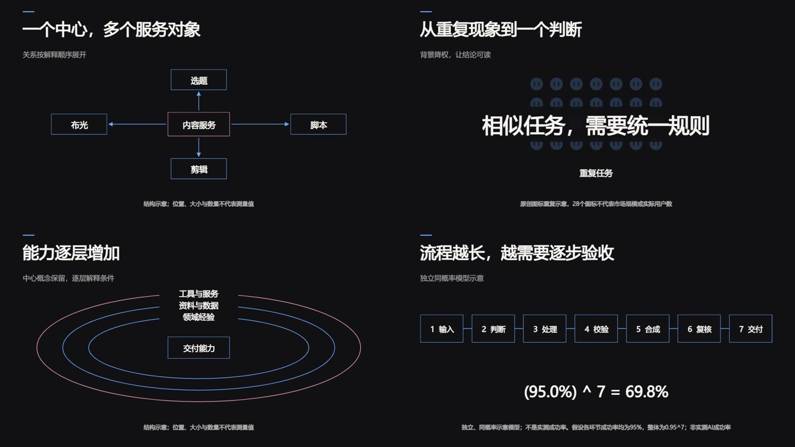

# 口播与图解交替：剪辑机制与可复用动效

本方法只研究剪辑、画面组织与动效，不分析或继承参考作品的选题、观点、论证、商业判断和运营效果。参考来源与观察范围单列在[研究记录](../evaluation/editing-reference-20261031.md)。四个图解是独立实现，未复制参考视频、人物、品牌图形、字体或配乐；也不属于 video-shotcraft 的九个上游适配。



## 剪辑规则

1. **按解释负担换版式。** 真人画面负责直接表达；屏幕操作、关系、集合和流程难以只靠口述时，让图解接管主画面。重点解释结束后回真人，保留视觉呼吸。不按固定“两秒一切”套全片。
2. **人物保持连续，注意力让给资料。** 图解段可留角落圆窗，较长的人物表达可用一侧竖窗。小窗避开字幕、标签和关系线；采用真实登记视频及明确源时间，不冒充自动人物抠像。
3. **先对象，再关系，最后结论。** 新对象错峰出现，连线随后描画；新层建立时保留旧层，减少观众反复寻找。结论出现时降低非重点明度，先保证阅读，再考虑运动量。
4. **用动作表达结构。** 复制、排列、圈层、串接和偏离分别对应不同的画面关系。单纯换色或增加缩放次数，不算新增剪辑逻辑。动画完成后至少留一秒稳定画面；复杂图解应延长停留或拆镜。
5. **字幕与图解分工。** 字幕承担语音可读性，图解只承载此时需要看的关键词与结构；不把整段字幕再次塞进卡片。字幕沿真实源时钟绑定，不能把组件内动画时钟称为逐字声学对齐。
6. **转场服务版式。** 同一布局中以直接切换、轻位移、淡入和逐项出现为主。真人和图解之间可编排缩放移位与固定圆窗，但不能把现有静态蒙版冒称连续圆角形变。

## 四个新增的可执行组件

通过 `GET /api/visual/shots?status=native_executable` 在 `native_cards` 检索；搜索 `q` 同时检索上游卡和原创卡，两组来源分别返回。旧 `cards` / `adaptations` 数量与来源保持原有定义。完整参数读 `shot-render` schema，提交与冻结/历史/导出流程沿用[镜头库](../skills/self-media-workflow/references/shots.md)。

| kind | 动作与输入 | 合适场景 | 适用边界 |
|---|---|---|---|
| `concept-network` | `center`、2–6个 `nodes`；节点错峰、连线描画；`direction=relation/inward/outward` | 一对多、输入汇聚、服务关系 | 箭头必须对应明确声明的方向；图形不证明真实因果或数据流 |
| `concept-matrix` | `label`、2–5行×2–8列、`conclusion`、必填 `data_note`；图标铺开→降权→结论 | 重复集合、相似项、从众多现象提炼一个判断 | 图标数量须说明示意或依据；不等于用户数、市场规模 |
| `layered-rings` | `center`、1–3个 `layers`；中心保留，椭圆圈层依次描画并加标签 | 能力层级、保护条件、作用范围 | 环大小为排版层级，不代表强度、占比或真实轨道 |
| `process-chain` | 2–7个 `steps`；节点连线递进；可选 `fail_step` 或独立同概率示意 | 端到端流程、局部失败、累积可靠性 | 失败路径与概率模型须分镜；数据说明始终可见 |

这些是运动机制的可换内容适配，不是参考画面的逐像素复刻。统一支持16:9、9:16、1:1，25/30fps，3–12秒；流程镜头须给各步足够阅读时间。渲染得到无声、不透明的H.264视频，完成后登记 generated 素材，再用原生时间轴组合真人、资料、字幕和声音。

关系图默认无向；需要流向才显式声明 `inward` 或 `outward`。圈层不含绕轨粒子；关系线不含沿复杂贝塞尔路径运动的金币；集合不是对原人物或品牌图标的复制器。

流程默认只表达结构。需要概率说明时，必须同时提供 `step_probability`（0–1）、`independent_assumption=true` 和非空 `data_note`。显示的是明确独立同概率假设下的 `p ^ n`，不能把相关步骤的成功率直接相乘，也不能当实测准确率。一个已有环节可用一基索引 `fail_step` 标记失败分支，并附说明；不与概率模型叠在同一镜头。

```json
{
  "kind": "process-chain",
  "title": "逐步验收，减少交付风险",
  "steps": ["输入", "处理", "复核", "交付"]
}
```

Agent查当前项目revision后把 `shot` 放入正常的渲染请求；使用者不需要填写JSON或坐标。标题、标签或说明超出可读范围会拒绝，不能靠持续缩小字号或裁字假装通过。

## 组合方式与保留的能力边界

| 观察到的手法 | 工作台采用方式 | 复用程度 |
|---|---|---|
| 真人大画面与图解交替 | 原生时间轴切镜，独立连续人声轨 | 可编排，需真实源时间与逐段审片 |
| 角落圆窗／一侧竖窗 | `masks` 或固定形状 `motion_layer`，真实视频裁切 | 可执行；连续圆角形变未实现 |
| 资料页面配标题及局部提示 | 原图/原视频、`motion_text`、`document_extract` 或 `spotlight` | 可执行；没有自动OCR/对象跟踪 |
| 对照、清单、重点词、数字落点 | 既有分屏、列表、标题、数字组件 | 已有组件；按作用选择，不另计新类型 |
| 关系图、重复矩阵、圈层、流程 | 本页四个原创组件 | 新增可执行；版式与运动经过简化 |
| 沿曲线路径运动的图标、连续形状变换 | 保留为参考动作，不能用近似片段冒充原样实现 | 这四个组件不提供 |
| 角色化三维类比短片 | 用户已有或另行授权生成的视频作为B-roll | 只支持登记与剪辑；没有三维生成引擎 |

## 复现与验收

`python scripts/diagram_acceptance.py --out <new-directory>` 通过真实API渲染四类组件的横屏、竖屏、方形，以及普通流程和失败分支，共14条；检查解码、帧数、运动、末秒停留、冻结来源、幂等重放和新进程恢复，再合成24秒静音演示。`--compact` 降低横屏测试尺寸，其他契约不变。此脚本只用原创示意标签/数据，不取参考视频作样片。

自动检查不是审美验收；实际输出还要看入场、运动中、稳定、字幕/小窗遮挡和阅读负担。声音留在最终时间轴，不把静音组件测试称为听审或成片运营验证。当前执行证据与未验边界见[本轮验收](../evaluation/explanatory-diagrams-20261031.md)。
