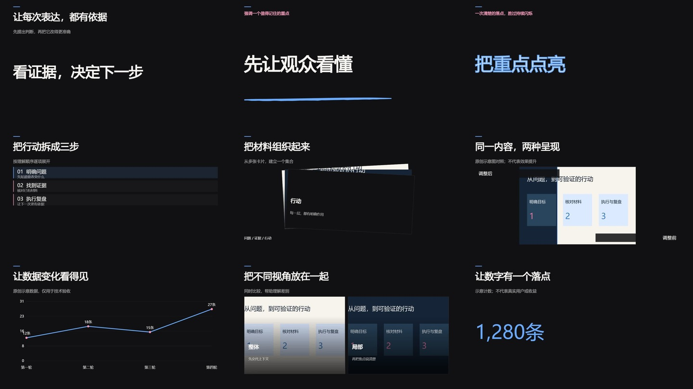

# 可选镜头库

本模块把 video-shotcraft 的参考词汇与工作台的项目/素材/原生时间轴连接起来，使用本机 Remotion 后台渲染，不提供网页编辑器。



Windows本机已完成21条横竖屏/高清/方形实际渲染、45秒原生时间轴合成和新进程恢复；完整106项回归通过。图为原创示意素材与数据的技术样片，不代表用户成片验收。[验收范围与失败修订](../evaluation/shot-library-20261030.md)。

固定上游版本：[`1266a3ec4831289c4d893d42dd5102723658039a`](https://github.com/Vincentwei1021/video-shotcraft/tree/1266a3ec4831289c4d893d42dd5102723658039a)。索引含124张卡、150个样式；9个参数化适配可执行，其余供Agent检索参考。原始选用配方与样例源保存在 `third_party/video-shotcraft/`，原始样例不是独立可运行工程，未复制原产品截图、音频、浏览器工作台和发布工具。

9类可执行镜头：打字改写、马克笔标题、空心字点亮、列表递进、卡片堆叠、前后对照、折线图、分屏、数字滚动。它们提取上游的运动语法并适配中文、画幅和时钟；不宣称逐像素复刻。数字滚动直接复用 Apache-2.0 的 DigitRoll，并以归一化帧时钟封装；笔触轮廓使用上游的固定种子算法。

2026-10-31另加入4个[原创解释型图解](explanatory-diagrams.md)：中心关系、重复集合、层层能力圈、流程链与累积风险。`native_cards` 与上游索引分开，合计13个参数化kind；学习的是剪辑/动效机制，不导入参考视频的观点、人物、图像或声音。四类已有14条实际横竖屏/方形渲染及24秒原生时间轴演示；[本轮验收](../evaluation/explanatory-diagrams-20261031.md)单独记录。

## 依赖与本机准备

普通功能仍只使用既有Python/FFmpeg依赖；镜头模块另需 Node.js/npm、`shot_renderer/package-lock.json` 中固定的 React/Remotion 依赖和兼容 Chrome。Agent执行：

```text
python scripts/setup_shots.py
# 可选：使用已经部署的兼容浏览器，避免再次下载
python scripts/setup_shots.py --browser <absolute-browser-executable>
```

设置 `SELF_MEDIA_SHOT_NODE` 和 `SELF_MEDIA_SHOT_BROWSER` 可指定本机路径。安装不修改全局 PATH/npm registry，不下载 ASR 模型。依赖和浏览器在本机保存；正常请求不会自动安装或上传。显式安装过程需要网络，后续任务只使用冻结的本地素材和字体。

Remotion独立许可见[官方条款](https://www.remotion.dev/docs/license)与[上游LICENSE](https://github.com/remotion-dev/remotion/blob/main/LICENSE.md)。个人/小公司与更大组织、视频工具自动化的许可条件需按实际使用核对，Apache-2.0不覆盖Remotion许可。没有打包第三方浏览器、字体、音乐或二进制；本机字体随任务冻结以确保复现，分享工程前仍须检查字体分发权。

## API与存储

Agent入口、实际 schema 和语义选择说明见[操作参考](../skills/self-media-workflow/references/shots.md)。发现接口 `/api/visual/shots`、运行状态 `/api/visual/shots/status`，提交 `/api/projects/{pid}/shot-renders`。CLI继续使用 `workbench.py call`，无需新增使用者记忆负担。

请求保存当前项目revision、reason、图像ID/哈希、字体、实际执行源码、依赖锁和上游版本。异步job完成后校验画幅、帧率、实际帧数与完整解码，自动登记 generated 素材；原生时间轴继续管理剪切、语音、音乐与最终合成。request_id支持相同请求幂等重放；不同内容必须新ID，保留失败和历史。

当前交付为不透明H.264无声镜头，支持16:9/9:16/1:1、25/30fps、3–12秒、末尾固定阅读停留。透明叠加层、任意上游卡自动执行、原生剪映导出、跟踪/抠像、自动语音逐字对齐不在本模块范围。长文需拆镜；数据/对照关系由Agent核实，服务只验证输入契约与技术结果。

不得为了动画数量把原文证据改写成漂亮假图；既有 document_extract/keyframe_layer/masks 和普通口播继续保留。按观看目的选择动作，避免重复入场、重复大幅冲击和不必要的声音。
