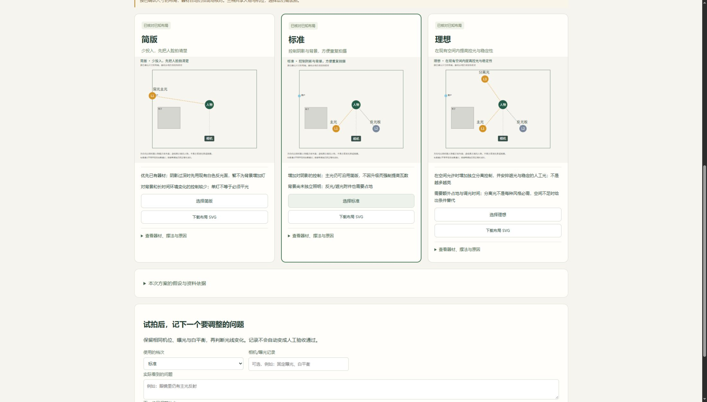

# 布光模块首版技术验收 · 2026-10-28

> 首版历史记录：教程规则版已停用产品中的自动Radiance/lux计算；现行功能见[后续验收](lighting-tutorial-rules-20261028.md)。数学通过不代表灯具瓦数选择正确。

结论：首版通过本地工程验收，可以交付三档布局建议、独立前端、版本选择与反馈。真实房间布光效果、新手独立摆放、换人复做、手机浏览器和本轮macOS运行尚未验证，不属于通过项。

## 本机实际执行

Windows / Python 3.11，项目与验收数据隔离。最终完整回归：`python -B -m unittest discover -s tests -v`，**92项，109.138秒，全部通过**；包含新增12项布光测试，本机配置了真实Radiance，交叉计算用例实际执行、未跳过。随后报告和页面细节修订后重跑12项，1.117秒全部通过。三个前端脚本的Node语法检查通过；运行网页不依赖Node。

新增测试覆盖：

- 图片真实解码、SHA256去重、原件篡改与跨项目拒绝。
- 每次恰好三档，缺尺寸不输出米数，缺光度数据不输出lux，默认草案不冒充审图。
- 可用窗光优先、障碍占地/高度、过小房间返回条件方案；SVG绑定相同灯位、用户文字转义。
- 修订冲突、请求幂等、保留旧版本、旧版不能误选为当前；试拍声明不自动变成人工通过，测量值需测点与方向。
- 灯具附件/CCT匹配、距离衰减与近场下限；可选Radiance与解析结果误差在2%内，明确列出计入及排除的灯。
- Agent意图路由及否定语义、四项schema、独立页面和脚本可访问。

最初新增测试发现FastAPI默认校验响应会回显Infinity导致JSON序列化500；修改为只返回校验类型、位置和消息，非法非有限数现在返回422。保留这一失败边界作为回归用例。

## 合成平面图与导出

调用Agent实际查看了[自绘平面图](fixtures/lighting/scene-demo.png)，记录图中4m×3m、左侧窗、左下柜子、人物及相机。另行输入的层高2.6m、面部1.2m、柜高1.8m与模拟灯数据均明确列为合成假设，不是图片识别结果。

通过HTTP实际执行上传 → 未知尺寸草案 → 带观察的场景新版本 → 查询两版历史 → 下载三份SVG、plan.json及HTML报告。复现入口：

```sh
python evaluation/run_lighting_acceptance.py --base http://127.0.0.1:PORT --out /absolute/path/to/acceptance
```

请对隔离服务运行；脚本会新建一个标记为模拟的项目。脚本复用已审阅图的声明，不自带视觉识别模型。

合成输入1000lux@1m、5600K、裸灯、标称输入78W（全为虚构测试数值）下，标准/理想档主光直射解析值499.14lux，真实Radiance子进程值499.18lux。理想档的未标定分离光和反光板明确排除于该值；简版采用窗光，资料不足，未输出lux。该结果只证明数值链路和降级规则，不验证78W真实灯具或现场相机观感。

## 浏览器实际操作

在Codex内置浏览器实操：独立工作台侧栏进入布光页；选择并上传合成PNG；生成三档；展开标准档查看器材、功率登记值、位置/高度及理由；选择标准；填写并保存模拟反馈；回看旧版；尝试选择旧版得到预期拒绝，再选当前版成功。最终浏览器warn/error日志为空。未把后端接口调用冒充页面点击。



页面截图展示合成场景。桌面窗口已视觉检查；CSS包含窄屏布局，但本轮没有实际窄屏/手机浏览器验收。

## 范围与下一步

首次选型的五项独立Radiance数学检查见[规划证据](../docs/plans/lighting-planner.md)。本机可选引擎来自官方6.0.2 Windows发行包；仓库不携带二进制。本轮未实跑Lightmap或Lighting Lab，未复用其代码。

目前是单人固定口播的规则规划器：Agent审图或用户确认场景后才能把建议与真实图片内容绑定；纯网页上传提供假设草案。没有真实灯具选购数据库、完整IES配光、侧视图、原图透视标注、自动房间重建或真实反射预测。额定W、照度估算和现场测量分开保存。

后续应在带窗、白墙、深背景三个真实房间，固定机位/曝光/白平衡进行前后对照，记录新手摆放用时、求助、调整次数，再由另一人复做；通过后才能升级效果与易用性声明。GitHub Actions以对应提交的在线结果为准，不将本地通过写成云端跨平台已通过。
