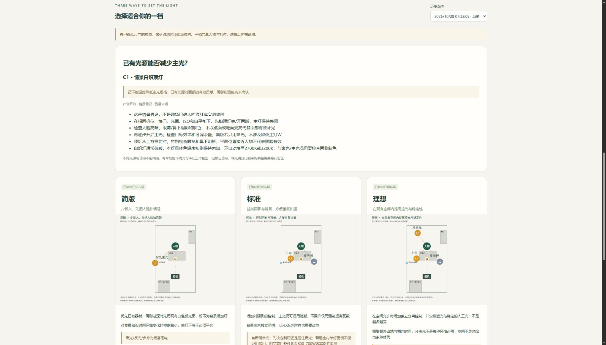

# 顶灯上下文技术验收 · 2026-10-28

策略：`tutorial-context-v3-20261028`。平面图可附已有光源清单，灯具类型、投影位置、功率/色温、开关、面部观察与假设依据分开保存。输出有用补光、仅背景、不利阴影/混色、关闭或待对照结论；不以W相减、不凭灯种填色温、不自动降低主灯采购规格。

## 实际执行

Windows / Python 3.11：布光专项**21项，1.032秒，全通过**；完整回归**101项，140.013秒，全通过**；JS语法检查通过。本轮新增5项上下文测试，包含未知白炽灯不编色温或减幅、有用补光仍非采购结论、不利/背景/关闭分支、已知效果须填依据、无效数值/坐标拒绝、报告和前端字段、顶灯投影不占灯架地面空间。

在此前3×5m、15㎡坐播模拟项目中，读取原有场景，另存“中央有白炽顶灯并计划开启”的情景。位置和开关均明确是假设，W/K未知，未声称从原图看到了顶灯，也未伪造开关实拍。实际调用生成得到 `needs_comparison`，W和调光减幅为null，降低采购W为 `not_established`。生成前后读取旧方案逐项相等。

浏览器实际展开补充项，核对白炽灯/开启/未知W与K/尚未对照/观察说明，点击生成，界面显示上下文判断，保留旧版并增加新版本。最后浏览器warn/error日志为空。C1在布局中仅是已有顶灯的俯视投影，不额外占地或被当作实际光束。

## 判断边界

“有帮助的面部补光”分支根据调用者的声明与依据，仍未独立验证；它只允许提示可能减少工作输出，不给定减少多少W/百分比。现场应固定机位、快门、光圈、ISO、白平衡和其他环境条件，主灯关闭时对比顶灯关/开，再逐渐加入主光检查目标效果、余量和肤色。

本轮没有真实顶灯、相机曝光或灯具采购验证。白炽灯偏暖及混色注意来自ARRI、爱图仕和大学教育资料，来源及许可见[教程依据](../docs/lighting-sources.md)。同色温数值不能单独保证颜色匹配。历史Radiance诊断仍不进入产品规划。云端CI以对应提交的在线结果为准。
