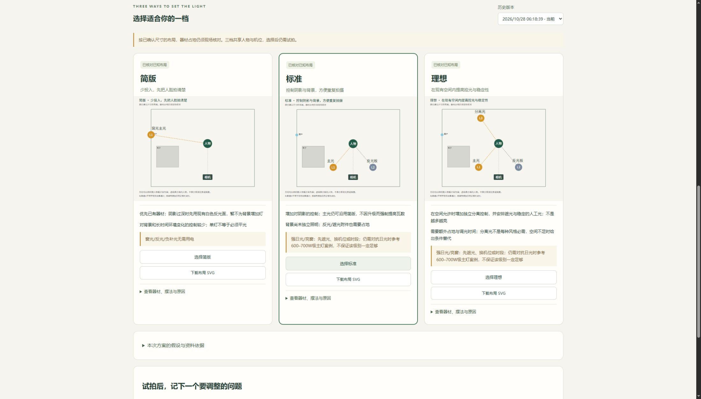

# 教程规则版布光验收 · 2026-10-28

策略版本：`tutorial-rules-v2-20261028`。此次纠正布光选型的方法与表达：不使用Radiance或lux反算灯具输入W，也不把登记的78W等虚构测试值当成推荐规格。原版实际上未从lux计算W，但把登记值与模拟照度同列容易造成误解，现已分开处理。

## 实际检查

- Windows / Python 3.11完整回归：**96项，126.819秒，全部通过**。反射路径的条件状态和图示细节补齐后，再跑布光专项**16项，0.858秒，全部通过**。JS语法检查通过。
- 新增测试用替身让Radiance调用直接抛错，正常生成三档依然成功，证明产品路径不调用它；`calculation=null`、`suggested_input_watts=null`、`radiance.state=not_used`。
- 同一场景按环境光切换规则，三档不自动逐档提高瓦数；未知环境不默认低W；已有灯功率不会自动判定够用或强制升级；反射/宽景/强日光均有不同检查项。
- 反射面没有登记时，人工主光方案为条件方案，朝向/高度未确认，不画直射人物的光路。它不是已经完成的反射布光设计。
- 每条规则绑定来源ID；CC BY作者、许可和原文链接保留。历史Radiance测试作为独立开发诊断运行，不参与选型结果。

## 浏览器实操

在已有合成平面图项目上回看旧方案，确认显示“旧照度不用于选瓦数”；展开场景补充项，选择强日光、柔光箱、宽景，将附件登记改为明确标记的合成90cm柔光箱与网格，实际点击生成并选择标准档。三档与旧版均保留，标准和理想显示有条件的高输出案例提示；没有把它变成采购保证。最终浏览器warn/error日志为空。

图中房间、灯具W和环境条件全部是声明的模拟场景，不是实拍验证。界面与HTTP导出分别检查；页面不自动识图，调用Agent查看照片后登记的观察仍需明确来源。

## 资料依据与未执行项

实际阅读的教材/教程、许可状态、规则对应和访问失败候选详见[教程依据](../docs/lighting-sources.md)。大学CC BY摄影章节用于基础流程，不直接照搬静态摄影曝光参数；ARRI/神牛/爱图仕材料只作版权参考。SUNY新教材仅核实元数据与CC BY许可，正文未取得，未作为已审阅规则依据。

没有真实房间照度、真实灯具余量或新手复做验收；没有通过修改W标签证明灯具足够。当前采用“教程条件→场景分支→实际附件与余量核对→现场试拍”的建议链，不能承诺一键精确选瓦数。云端结果以对应提交的实际CI为准。
